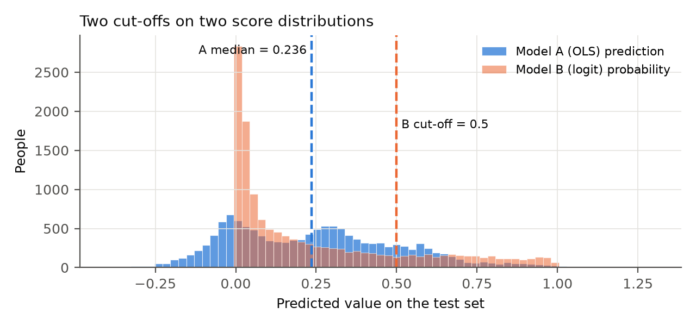
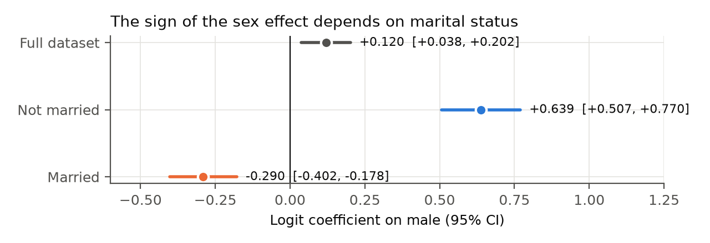
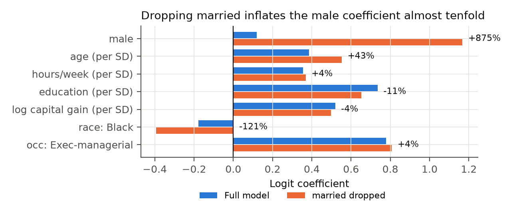
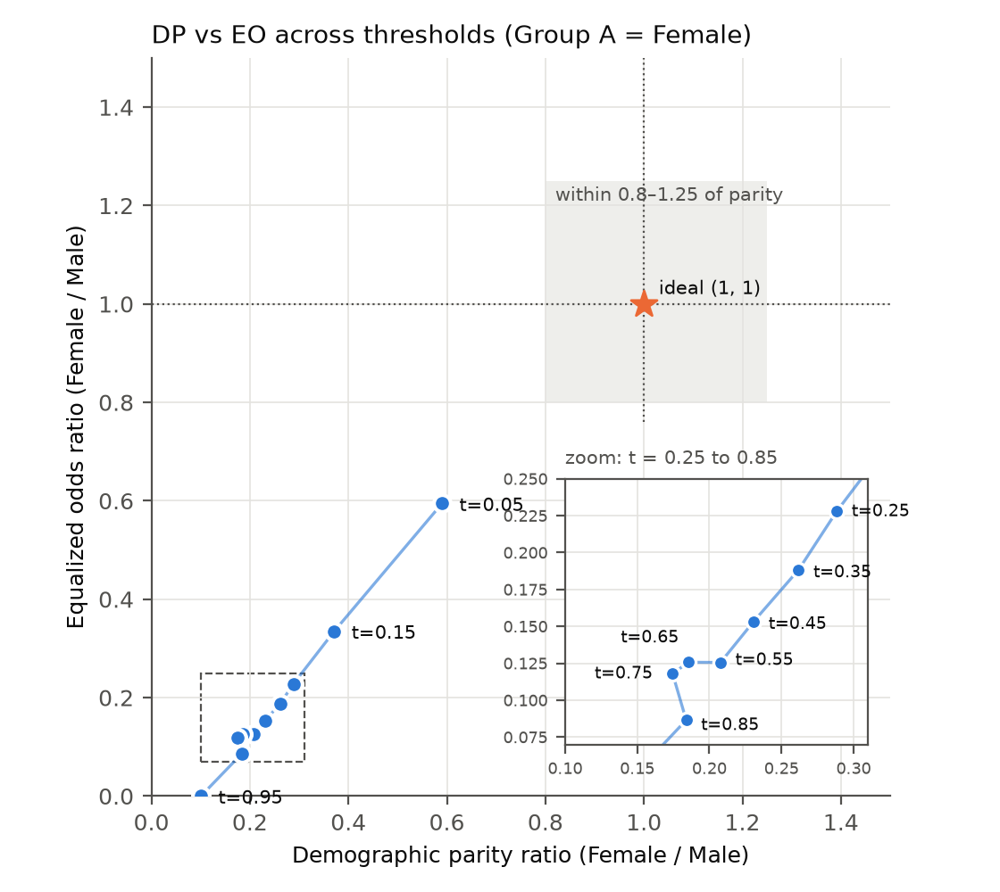
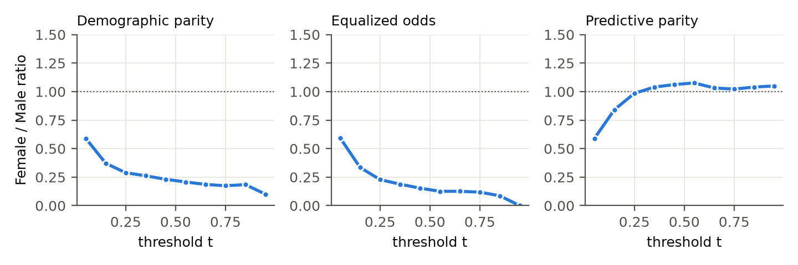

# CSET485 AI and Society: Assignment 1

Stress-testing an income classifier on the Adult Census data

| | |
|---|---|
| Name | Rishant Ranjan |
| Enrollment number | S24BCAU0036 |
| Dataset | Adult Census Income (roll number ends in 6) |
| Random seed | 36 (last three digits of the roll number) |
| Code | `CSET485_Assignment1_AdultIncome.ipynb` in the GitHub repository linked at the end |

Every number in this report comes from the notebook. Running it from top to bottom regenerates all tables in `results/` and all charts in `figures/`.

---

## Data preprocessing

I joined the two UCI files, `adult.data` (32,561 rows) and `adult.test` (16,281 rows), into one table of 48,842 people. The test file has a junk first line and labels that end in a full stop (`>50K.`), so I skipped the line and stripped the stop. The target is `y = 1` if income is above $50K. Then I made my own stratified 70/30 split with `random_state = 36`: 31,607 training rows and 13,547 test rows, each with 24.8% positives.

Missing entries are coded `?`, and they appear in only three columns: `workclass` (2,799), `occupation` (2,809) and `native_country` (857). Nearly every row missing `workclass` is also missing `occupation`. I dropped all 3,620 incomplete rows (7.4%). Imputing an occupation would mean inventing one of the model's strongest predictors, and losing 7.4% of the rows still left plenty of data.

I removed 47 exact duplicate rows. These match on every column, including the survey weight, so they are double entries. `workclass = Without-pay` has 21 rows with only 2 high earners, which made the logistic fit unstable (quasi-separation), so I dropped those rows. I merged `Armed-Forces` (14 rows) into `Protective-serv`. The final dataset has 45,154 rows.

I dropped three columns. `fnlwgt` is a sampling weight, not a property of the person. `education` maps one-to-one onto `education_num`. `relationship` is mostly marital status × sex (`Husband`, `Wife`), so keeping it beside `married` and `male` would spread one effect over collinear columns.

For categorical encoding, I coded three binaries: `male` (1 = Male), `married` (1 = Married-civ-spouse or Married-AF-spouse) and `native_us` (1 = United States, 91% of rows). `race`, `workclass` and `occupation` became one-hot dummies, with White, Private and Adm-clerical as the reference levels. This gives 29 features in total.

I removed no rows as outliers. The table below counts values outside 1.5 × IQR. The hours count looks large only because half the sample works exactly 40 hours, so the IQR is 40 to 45. `capital_gain` is zero for 91.6% of people and top-coded at 99,999 for 229 people. I applied `log1p` to `capital_gain` and `capital_loss` so those few large values don't dominate the linear terms.

| Feature | Min | Q1 | Median | Q3 | Max | Outside 1.5 × IQR |
|---|---|---|---|---|---|---|
| age | 17 | 28 | 37 | 47 | 90 | 268 (0.6%) |
| hours_per_week | 1 | 40 | 40 | 45 | 99 | 11,876 (26.3%) |
| capital_gain | 0 | 0 | 0 | 0 | 99,999 | 3,788 (8.4%) |
| capital_loss | 0 | 0 | 0 | 0 | 4,356 | 2,139 (4.7%) |
| education_num | 1 | 9 | 10 | 13 | 16 | 290 (0.6%) |

For scaling, I z-scored the five numeric features (age, education, hours, log capital gain, log capital loss) using the training-set mean and SD, then applied the same transform to the test rows. A numeric coefficient therefore means "change per one SD". One SD is 13.2 years of age, 2.5 years of schooling or 12.0 working hours.

---

## Part 1: Build

Model A is OLS on the 0/1 target, which makes it a linear probability model. Model B is logistic regression. I fit both with `statsmodels` on the same 29 features and training rows, without regularisation. Model A reaches R² = 0.369, and Model B reaches McFadden pseudo-R² = 0.386.

Thresholds on the test set (13,547 people):

- Model A's median prediction is 0.2358. Its rule flags 6,774 people as high risk (≥ median).
- Model B's rule flags 2,758 people (P ≥ 0.5).

| | B: low risk | B: high risk |
|---|---|---|
| A: low risk | 6,773 | 0 |
| A: high risk | 4,016 | 2,758 |

The two rules disagree on 4,016 people, 29.64% of the test set. Every mismatch runs the same way, with A flagging the person and B not. No one is flagged by B and missed by A.

The two scores rank people almost identically (correlation 0.941), so the disagreement comes from where each rule draws its line.

1. A median cut flags 50% of people by construction, whatever the base rate. Only 24.8% of the test set earns over $50K, so half the flags are bound to fall on lower earners. The 0.5 rule flags only 20.4%.
2. The lines sit at different points on the same ranking. At Model A's median, Model B's probability is about 0.145. Everyone B flags has an A score of at least 0.384, well above A's median of 0.236, so B's flagged group is a subset of A's.
3. OLS is not bounded. Model A predicts below 0 for 2,861 people and above 1 for 70, so a value like 0.236 isn't a probability anyone can interpret.

Against the true labels, Model A's rule has accuracy 0.720, precision 0.468 and recall 0.943. Model B's rule has accuracy 0.841, precision 0.719 and recall 0.590. Rule A catches almost every high earner but pays for it with 3,606 false alarms.

---

## Part 2: The trap

### 2.1 Simpson's paradox

I split the data by marital status (`married` = 1 or 0) and tracked the coefficient on `male`. Following the brief, I fit all three models on the full cleaned dataset rather than only the training split. The full model includes `married` as a covariate. In the subgroup models `married` is constant, so it drops out.

| Model | n | Coef. on `male` | 95% CI | p-value | Odds ratio |
|---|---|---|---|---|---|
| Full dataset | 45,154 | +0.120 | [+0.038, +0.202] | 0.0042 | 1.13 |
| Subgroup A: not married | 24,093 | +0.639 | [+0.507, +0.770] | 1.6 × 10⁻²¹ | 1.89 |
| Subgroup B: married | 21,061 | −0.290 | [−0.402, −0.178] | 3.6 × 10⁻⁷ | 0.75 |

The coefficient reverses sign. The two subgroup confidence intervals don't overlap, and neither one contains zero. A pooled model with a `male × married` interaction gives −1.085 (95% CI [−1.243, −0.928], p = 1.7 × 10⁻⁴¹), so the difference between the slopes is real.

The reversal shows up in the raw rates too, with no model involved:

| Share earning > $50K | Women | Men |
|---|---|---|
| Not married | 5.1% (n = 12,443) | 8.6% (n = 11,650) |
| Married | 46.6% (n = 2,230) | 45.3% (n = 18,831) |
| All | 11.4% | 31.3% |

In the data, 61.8% of the men are married, against 15.2% of the women, and married people earn over $50K about five to nine times as often as unmarried people. Most of the raw male advantage therefore comes from how the two sexes are spread across marital status. Fitting `male` alone gives a coefficient of 1.266 (odds ratio 3.55). Adding `married` cuts it to 0.120. Inside each marital group the sign then splits. The full model forces one shared slope for `male` and lands on a weighted blend of +0.639 and −0.290.

The married women here are a small, selected group (2,230 out of 14,673 women). The data doesn't say how they came to be in the sample. That selection is a plausible reason their rate edges past married men's, but I can't confirm it from these columns.

A policymaker reading only the full model would see a small gender effect (odds ratio 1.13) and could decide gender barely matters once other things are controlled. One reading only the raw rates would see a large effect (odds ratio 3.55) and might design a policy for all women. The subgroup models give a sharper picture. The gap sits among unmarried people (odds ratio 1.89 in favour of men, and only 5.1% of unmarried women clear $50K), while married women in this sample do slightly better than married men. A support programme aimed at unmarried women, such as single mothers, fits the evidence better than a blanket gender policy. A blanket policy would spend money on a married group that shows no disadvantage here.

### 2.2 Omitted-variable bias

I dropped `married`. It correlates with `male` (r = 0.437) and with `age` (r = 0.305), 89.4% of married people in the data are men, and it has the largest coefficient in the model (2.377, odds ratio 10.8). I fit the full logit and the reduced logit (without `married`) on all 45,154 rows.

| Predictor | Full model | Without `married` | % change |
|---|---|---|---|
| male | 0.1198 | 1.1675 | +874.7% |
| race: Black | −0.1777 | −0.3923 | −120.7% |
| age (per SD) | 0.3857 | 0.5525 | +43.2% |
| education (per SD) | 0.7348 | 0.6519 | −11.3% |
| log capital gain (per SD) | 0.5191 | 0.4980 | −4.1% |
| occupation: Exec-managerial | 0.7774 | 0.8073 | +3.9% |
| hours per week (per SD) | 0.3561 | 0.3686 | +3.5% |

% change = (reduced − full) / |full| × 100. For race: Black, the coefficient grew more negative, so its size went up by 121%.

The `male` coefficient moved the most, from 0.120 to 1.167. That is the largest jump in relative terms (+875%) and in absolute terms (+1.048). As an odds ratio, the "male effect" goes from 1.13 to 3.21 depending on whether one column is in the model. Age absorbs part of the marriage effect too (+43%), because older people are more often married. The reduced model also fits worse (pseudo-R² 0.390 → 0.292, AIC 30,937 → 35,850), but the coefficient tables alone give no hint that anything is missing. All the remaining coefficients stay significant and keep sensible signs.

Someone handed only the reduced model would report a large, highly significant gender effect, and nothing in its output would warn them. Whether `married` is a confounder or a mediator (marriage could itself be shaped by income and sex) is a causal question the data can't settle. Either way, the number quoted as "the gender effect" depends on a modelling choice. I answer how to look for a confound we can't see in Part 3, Q4.

### 2.3 Adversarial subset

On the test set, Model B makes 751 confident wrong predictions (5.54% of 13,547). Of these, 179 are confident false positives (P ≥ 0.75, actual ≤ $50K) and 572 are confident false negatives (P ≤ 0.25, actual > $50K). I drew 50 at random with seed 36, which gave 39 false negatives and 11 false positives.

| Trait | Full test set | Sample of 50 | Its 39 FNs | Its 11 FPs |
|---|---|---|---|---|
| Mean age | 38.5 | 39.7 | 37.4 | 47.9 |
| Female | 32.0% | 26.0% | 30.8% | 9.1% |
| White | 86.0% | 94.0% | 92.3% | 100% |
| Married | 46.5% | 64.0% | 56.4% | 90.9% |
| Education ≤ 10 yrs (HS / some college) | 67.6% | 58.0% | 71.8% | 9.1% |
| Education ≥ 13 yrs (bachelor's+) | 25.1% | 30.0% | 17.9% | 72.7% |
| Hours > 40 | 31.2% | 42.0% | 41.0% | 45.5% |
| Capital gain = 0 | 91.6% | 86.0% | 100% | 36.4% |
| Capital gain or loss > 0 | 13.2% | 22.0% | 5.1% | 81.8% |
| Mean predicted P | 0.247 | 0.312 | 0.161 | 0.846 |

The 50 rows come in two kinds.

- All 39 false negatives (78% of the subset) have zero capital gain. 72% of them stopped at a high-school or some-college education. They earn over $50K while looking, on every feature the model sees, like typical lower earners. Their mean predicted P is 0.161.
- 9 of the 11 false positives (82%) report some capital gain or loss. 10 of the 11 are married, and 8 have a bachelor's degree or higher.

The model fails confidently for two separate reasons, and both show up in the notebook.

1. *An information gap, not a calibration bug.* Within the band P = 0.10 to 0.25, the model predicts 16.8% on average and 18.2% of people are actual high earners. The model is calibrated, and the false negatives are the 18% it expects to miss in that band. The data doesn't record overtime, seniority, union membership or industry, so the model has nothing that separates a $55K welder from a $35K one.
2. *A non-linear relationship forced into a straight line.* `log_cap_gain` enters the logit as a single slope (0.513 per SD). Yet in the raw data, 0 of the 614 people with a capital gain of $1 to $3,000 earn over $50K. Among people with zero gain the rate is 21.3%, and above $7,000 it is 98.7%. The model still adds +1.58 to the log-odds for a $2,000 gain. That push, together with the `married` coefficient of 2.34, moves married graduates with small capital gains past 0.75. When I replaced the log term with three capital-gain bins, confident false positives fell from 179 to 136, confident false negatives fell from 572 to 543, and accuracy rose from 0.841 to 0.850. Five of the 11 sampled false positives dropped below 0.75.

### 2.4 Fairness trade-off

Sensitive variable: sex. Group A = Female (4,339 test rows, base rate 11.2%), Group B = Male (9,208 test rows, base rate 31.2%). All metrics come from Model B's test-set probabilities.

| t | DP | EO | PP | TPR F / M | FPR F / M | Accuracy |
|---|---|---|---|---|---|---|
| 0.05 | 0.590 | 0.594 | 0.590 | 0.957 / 0.984 | 0.361 / 0.608 | 0.608 |
| 0.15 | 0.371 | 0.335 | 0.841 | 0.819 / 0.938 | 0.137 / 0.409 | 0.750 |
| 0.25 | 0.288 | 0.228 | 0.985 | 0.678 / 0.855 | 0.065 / 0.283 | 0.807 |
| 0.35 | 0.262 | 0.188 | 1.040 | 0.581 / 0.765 | 0.036 / 0.193 | 0.835 |
| 0.45 | 0.231 | 0.153 | 1.061 | 0.460 / 0.672 | 0.020 / 0.132 | 0.844 |
| 0.55 | 0.208 | 0.126 | 1.076 | 0.361 / 0.578 | 0.011 / 0.091 | 0.842 |
| 0.65 | 0.186 | 0.126 | 1.032 | 0.252 / 0.470 | 0.007 / 0.054 | 0.834 |
| 0.75 | 0.174 | 0.118 | 1.022 | 0.165 / 0.331 | 0.003 / 0.026 | 0.815 |
| 0.85 | 0.184 | 0.086 | 1.040 | 0.105 / 0.197 | 0.001 / 0.009 | 0.793 |
| 0.95 | 0.101 | 0.000 | 1.050 | 0.021 / 0.070 | 0.000 / 0.002 | 0.767 |

At every threshold EO equals the FPR ratio, because men are wrongly flagged far more often than women.

Across most of the sweep, DP and EO rise and fall together, because both improve as the threshold drops. The one place where they pull apart is the step from t = 0.75 to t = 0.85:

> If you improve DP from 0.174 to 0.184 (a 5.4% gain), EO drops from 0.118 to 0.086 (a 26.8% loss). The trade-off cost is 26.8 / 5.4 = 4.93.

The larger conflict is between DP and predictive parity:

> Moving from t = 0.25 to t = 0.05 improves DP from 0.288 to 0.590 (a 104.6% gain), PP drops from 0.985 to 0.590 (a 40.1% loss), and accuracy falls from 0.807 to 0.608. The trade-off cost is 40.1 / 104.6 = 0.38.

No threshold comes close on all three metrics. PP stays within 0.84 to 1.08 for every t ≥ 0.15. DP and EO never pass 0.6 anywhere. Base rates explain the DP ceiling: if the model were perfect, DP would equal 0.112 / 0.312 = 0.358. I recommend t = 0.25. At that point PP is closest to 1 (0.985), so a positive prediction means the same thing for both sexes. DP (0.288) and EO (0.228) are better than at the default 0.5 region (0.208 and 0.126 at t = 0.55), and accuracy (0.807) gives up 3.7 points against the best value of 0.844. Part 3, Q7 defends this choice and gives the case against it.

---

## Part 3: Descriptive analysis questions

### Q1. Why did the two thresholding approaches flag different people?

The two rules disagreed on 4,016 of the 13,547 test cases, or 29.64%, and every disagreement went the same way. In all 4,016 cases Model A called the person high risk and Model B did not. The opposite corner of the confusion table is zero, so B's 2,758 flagged people sit entirely inside A's 6,774.

The scores themselves barely disagree. Linear and logistic predictions correlate at 0.941, so both models rank people in nearly the same order. The cut is what differs. Model A's median prediction is 0.236, close to the 24.8% base rate, while logistic regression cuts at 0.5, more than twice as high. For the person sitting at A's median, the logistic model gives a probability of about 0.145. Rule A therefore flags people whom Model B rates at roughly a 15% chance of earning over $50K.

The median rule also ignores the base rate. It flags exactly half the people whatever the data says. Only a quarter are high earners here, so at least half of A's flags must be wrong, and its precision is 0.468 against 0.719 for B. Rule B flags only people rated more likely than not to be high earners: 20.4% of the test set, close to the true 24.8%.

The linear model adds one more problem. It predicts below zero for 2,861 people and above one for 70, so a score of 0.236 has no meaning as a probability. The logistic model maps the same linear signal into (0, 1), and its 0.5 cut sits at log-odds zero.

So the rules differ in how many people they choose to call high risk. Rule A catches 94.3% of real high earners and rule B catches 59.0%. Which is better depends on whether a miss or a false flag costs more.

### Q2. The subgroup and why the trend reverses

I split the data by marital status and tracked the coefficient on `male`. In the full model (45,154 rows, `married` as a covariate) it is +0.120, 95% CI [0.038, 0.202], p = 0.004. Among unmarried people (n = 24,093) it rises to +0.639 [0.507, 0.770], an odds ratio of 1.89. Among married people (n = 21,061) it flips to −0.290 [−0.402, −0.178], an odds ratio of 0.75. The subgroup intervals don't overlap, and an interaction model puts the difference at −1.085 [−1.243, −0.928], p = 1.7 × 10⁻⁴¹. Raw rates show the same reversal: 46.6% of married women earn over $50K against 45.3% of married men, while among unmarried people women trail men 5.1% to 8.6%.

The cause is composition. 61.8% of men in the data are married but only 15.2% of women, and married people clear $50K at about 45% against 5 to 9% for unmarried people. Men's overall lead (31.3% against 11.4%) mostly reflects being in the high-earning marital group. A model with `male` alone gives 1.266. Adding `married` shrinks it to 0.120, a blend of the two opposite slopes that the subgroup models separate. The 2,230 married women are a small, selected slice of 14,673 women, which is my best guess for why they edge out married men, though the columns can't confirm it.

If the subgroups were ignored, the policy conclusion would change. From the full model alone, a policymaker might decide gender adds little once marriage and occupation are controlled, and do nothing. From the raw rates, they might fund a programme for all women. The subgroup result puts the disadvantage among unmarried women, only 5.1% of whom earn over $50K. Childcare or training support for single mothers matches that evidence. A blanket policy would also spend on married women, who show no gap here.

### Q3. Omitted-variable test

I dropped `married`. It has the largest coefficient in the full model (2.377, odds ratio 10.8), it correlates with sex (r = 0.437) and age (r = 0.305), and 89.4% of married people in the sample are men. That makes it the obvious confounder for the gender effect.

| Predictor | Full | Without `married` | % change |
|---|---|---|---|
| male | 0.120 | 1.167 | +874.7% |
| race: Black | −0.178 | −0.392 | −120.7% |
| age (per SD) | 0.386 | 0.553 | +43.2% |
| education (per SD) | 0.735 | 0.652 | −11.3% |
| log capital gain | 0.519 | 0.498 | −4.1% |
| hours per week | 0.356 | 0.369 | +3.5% |

The `male` coefficient shifted most. It rose almost tenfold, taking its odds ratio from 1.13 to 3.21. Without `married`, the model credits sex with the effect of being married, because most married people in the data are men. Age absorbs part of the same effect (+43%), since older people are more often married. The race: Black coefficient more than doubled in size, which suggests marriage rates differ by race in this sample. Education fell by 11%, so some of what looked like an education effect was riding on marriage as well.

The reduced model still looks healthy. Every listed coefficient stays significant with a plausible sign. Only the fit statistics hint at trouble: pseudo-R² falls from 0.390 to 0.292 and AIC rises from 30,937 to 35,850, and those numbers mean little without the full model beside them. A reviewer given only the reduced model would accept "men have 3.2 times the odds of earning over $50K, all else equal" as a finding.

The headline gender effect moved by 875% when one plausible column went in or out, and no p-value flagged it. I would use an untested model's predictions, but I wouldn't read its coefficients as effects until I had checked which variables could be confounding them.

### Q4. How to detect a confound I can't currently see

I would re-fit the model on richer data and use the `married` result as a yardstick for how big a hidden confound has to be to matter.

1. Get a dataset with more columns. The US Census Bureau's American Community Survey (ACS) public-use microdata covers the same population as Adult with many more variables. The `folktables` package (Ding et al., 2021) already builds an ACSIncome task with the same > $50K target. From the raw PUMS files I would add state, industry code, number of children and full-year work status. Industry is the strongest candidate, because men and women cluster in different industries and industries pay differently.

2. Re-run my exact model, then add one column at a time. I fit my 29-feature logit on ACS data and check that the `male` coefficient lands near 0.120. If it doesn't, the 1994 sample is itself suspect. Then I add each new variable and record how far `male`, `age` and `education_num` move. A variable that shifts `male` by more than its confidence-interval width (about 0.16 here) is a confound my model is missing.

3. Bound what no survey measures. Ability and family wealth aren't recorded anywhere. For those I would run a sensitivity analysis along the lines of Cinelli and Hazlett (2020), asking how strongly an unseen variable must be tied to sex and income to erase the `male` effect. My data gives the benchmark: `married`, with r = 0.437 to sex, moved the coefficient by 1.05 log-odds. If a confound one third that strong would flip the sign, I would not report the gender coefficient as a finding.

The plan takes a few days and uses only public data. It also hands a domain expert a list of candidate confounders with measured effects to review.

### Q5. The 50-row adversarial subset

The model made 751 confident mistakes on the test set (5.54%): 572 confident misses (P ≤ 0.25, actual > $50K) and 179 confident false alarms (P ≥ 0.75, actual ≤ $50K). My random sample of 50 has 39 misses and 11 false alarms.

All 39 misses (78% of the subset) have zero capital gain. 72% of them stopped at high school or some college, 44% are unmarried, and their mean predicted probability is 0.161. They earn over $50K without the markers the model rewards. In the false alarms, 9 of 11 (82%) report a capital gain or loss, 10 are married, 8 hold a bachelor's degree or more, and their mean age is 47.9 against 38.5 for the test set.

The two halves fail for different reasons. For the misses, the model is calibrated but has too little information. In the 0.10 to 0.25 band it predicts 16.8% and the true rate is 18.2%, so these people are the expected minority of a mixed group. Their profile (40 hours, no capital gain, high-school education) matches most people under $50K, so the education coefficient (0.751 per SD) and the married coefficient (2.34) place them beside their lower-earning look-alikes. The data has no overtime, union or seniority field to tell them apart.

For the false alarms, the model is mis-specified. `log_cap_gain` enters as one straight line (0.513 per SD), so any positive gain raises the score, and a $2,000 gain adds +1.58 to the log-odds. Yet 0 of 614 people with gains of $1 to $3,000 earn over $50K. The real pattern is a step: 0% there, 28.6% at $3,001 to $5,100, and 98.7% above $7,000. Add the married coefficient and a degree, and the score passes 0.75 for people earning under $50K. Three capital-gain bins cut confident false alarms from 179 to 136 and moved 5 of the 11 sampled cases below 0.75.

### Q6. What the trade-off cost means for real people

Suppose a bank uses this model to pre-approve a credit card that requires income above $50K. Two real people from my test set both score about 0.30:

- Person F: woman, 37, never married, professional-school degree, professional specialty job, 55 hours a week, earns over $50K. P = 0.302.
- Person M: man, 58, married, high-school graduate, craft repair, 40 hours a week, earns under $50K. P = 0.300.

At t = 0.45, near the most accurate cut (accuracy 0.844), both are rejected. That is right for M and wrong for F. At this threshold the model recognises 46.0% of women who earn over $50K, against 67.2% of men. DP is 0.231 and EO is 0.153.

If the bank lowers the threshold to t = 0.25 to narrow the gender gap, both are approved. F gets the card she qualifies for, and TPR for women rises to 67.8%. M gets a credit line sized for an income he doesn't have, and the share of under-$50K men wrongly approved rises from 13.2% to 28.3%. DP improves to 0.288 and EO to 0.228, while predictive parity slips from 1.061 to 0.985 and accuracy drops to 0.807, about 500 more wrong decisions across the test set. Men like M carry most of those errors as debt they may not be able to repay.

Pushing the other way shows the cost on my chart. Moving from t = 0.75 to t = 0.85 raises DP by 5.4% (0.174 to 0.184) and cuts EO by 26.8% (0.118 to 0.086). Women's TPR drops from 16.5% to 10.5%, so a woman like F would almost never be approved. The cost ratio of 4.93 means each point gained on equal approval rates costs almost five points on equal error rates, and qualified women bear most of that loss.

### Q7. Defending t = 0.25

I would pick t = 0.25, for three reasons.

First, predictive parity is 0.985, the closest to 1.0 in the sweep. A flagged woman earns over $50K 56.9% of the time and a flagged man 57.8% of the time, so a positive prediction means the same thing for both sexes.

Second, it narrows the gaps the default cut leaves wide. Women's TPR is 0.678 against 0.855 for men, a ratio of 0.793, just under the four-fifths line. At t = 0.55 that ratio is 0.625. DP rises from 0.208 to 0.288 and EO from 0.126 to 0.228. A woman earning over $50K has about a one-in-three chance of being missed at t = 0.25, and nearly two in three at 0.55.

Third, the accuracy cost is modest. Accuracy is 0.807, against 0.844 at the best threshold (t = 0.45), a loss of 3.7 points. Accuracy for women stays at 0.907, and for men it is 0.760.

The strongest objection is that predictive parity barely moves. It stays between 0.98 and 1.08 from t = 0.25 to 0.95, so it can't single out 0.25. What picks 0.25 over 0.35 or 0.45 is my judgement that missing qualified women is worse than wrongly flagging men. A critic can fairly say the price falls on men below $50K: 28.3% of them are wrongly flagged at t = 0.25, against 19.3% at t = 0.35 and 6.5% for women. In lending, those men take on credit they can't afford. The critic can also point out that DP is still 0.288, far below any parity standard, so calling this threshold "fair" overstates it. I accept both points. I can defend t = 0.25 as the least unfair option in this sweep, and a fix would need better features, a better label or group-aware decisions.

### Q8. Demographic parity or equalized odds?

For income classification I would prioritise equalized odds, and within it, equal true-positive rates.

The base rate decides it. In my test set 11.2% of women and 31.2% of men earn over $50K, so even a perfect classifier gives DP = 0.112 / 0.312 = 0.358. Reaching DP = 1 would mean approving women at the men's rate regardless of income. At t = 0.25 men are flagged at 46.2%. Flagging women at 46.2% too would make at least 35 of those points, or 76% of flagged women, people who don't earn over $50K. In a lending or eligibility decision, that sets them up to fail.

Within a single-threshold sweep the two metrics mostly agree. Both peak at t = 0.05 (DP 0.590, EO 0.594), where accuracy collapses to 0.608 and 60.8% of men under $50K are flagged. They split when a policymaker chases one of them, as between t = 0.75 and 0.85, where a 5.4% DP gain cost 26.8% of EO. Equalized odds asks for something achievable: a woman who earns over $50K should be recognised as often as a man who does. At t = 0.25 that TPR ratio is already 0.793.

The metric I sacrifice is demographic parity. At t = 0.25 women get positive predictions at 13.3% and men at 46.2%. I accept this because the gap tracks the gap in the label (11.2% against 31.2%), and a classifier can't close a labour-market gap by mislabelling people. The label itself comes from 1994 wages with their own history of discrimination, and equalized odds will reproduce that history. Wage and childcare policy has to close that gap. What I can ask of the model is that it adds no extra errors for women on top of it.

---

## Part 4: Reflection

*"Just give me one number: should we deploy this model or not?"*

### 1. Direct answer

Conditional deployment. I would use it only as a screening aid that a person reviews, never as an automatic decision, because its headline accuracy of 84.1% hides the fact that at the default cut it recognises 41.6% of women who earn over $50K against 61.9% of men.

### 2. Why a single number fails

*Overall accuracy hides subgroup gaps, and here it points the wrong way.* At t = 0.5, accuracy is 92.0% for women and 80.4% for men, so a dashboard would say the model works better for women. That happens because most women are true negatives and the model rarely says yes to them. Among the people who matter for a qualification decision, women who earn over $50K, it misses more than half.

*The threshold is a value judgement.* Two defensible rules, the median of a linear score and 0.5 on a logistic probability, disagreed on 29.6% of the test set. Moving the cut from 0.45 to 0.25 costs 3.7 points of accuracy and buys 21.8 points of TPR for women. The data can tell me the price of each option, but whether the trade is worth it depends on whether a missed qualified applicant is worse than a wrong approval. That is a policy decision.

*Fairness metrics conflict.* No threshold gets DP or EO above 0.6, and the threshold that maximises both (0.05) leaves accuracy at 0.608. Raising DP by 104.6% cost 40.1% of predictive parity, and raising DP by 5.4% at the high end cost 26.8% of EO. One number would have to pick a fairness definition silently.

*The model fails confidently in predictable places.* 5.5% of test predictions are wrong with at least 75% confidence. They cluster in two profiles: high earners with no capital gains, and married graduates with small capital gains. The second group comes from a modelling choice (a straight line where the data has a step), and fixing it removed 43 confident false positives.

*The coefficients depend on what was left out.* The male coefficient was 0.120 with `married` in the model and 1.167 without it, and it changed sign between married and unmarried people. I found that confound because I knew to look for it. Others, such as industry, aren't in the data at all.

### 3. Grounding in evidence

Mismatch between the two Part 1 rules: 4,016 people (29.64%). Simpson's reversal on `male`: +0.639 unmarried, −0.290 married, interaction p = 1.7 × 10⁻⁴¹. Omitted-variable shift: +874.7% on `male` when `married` is dropped. Adversarial subset: 751 confident errors, and all 39 sampled false negatives have zero capital gain. Capital gains of $1 to $3,000 have a 0% high-income rate but add +1.58 log-odds. Fairness: DP ≤ 0.59 at every threshold, and the DP-to-EO trade-off cost is 4.93.

### 4. Closing

Instead of one number, I would give the policymaker the threshold table from Part 2.4 with my recommended t = 0.25. Next to it I would write what that choice costs: 28.3% of lower-earning men wrongly flagged, DP stuck at 0.288, and confounds I couldn't test. The decision then rests with the person accountable for it.

---

## References

- Dua, D. and Graff, C. (2019). *UCI Machine Learning Repository: Adult Data Set.* University of California, Irvine.
- Hardt, M., Price, E. and Srebro, N. (2016). Equality of Opportunity in Supervised Learning. *NeurIPS*.
- Chouldechova, A. (2017). Fair prediction with disparate impact: A study of bias in recidivism prediction instruments. *Big Data*, 5(2).
- Ding, F., Hardt, M., Miller, J. and Schmidt, L. (2021). Retiring Adult: New Datasets for Fair Machine Learning. *NeurIPS*.
- Cinelli, C. and Hazlett, C. (2020). Making sense of sensitivity: Extending omitted variable bias. *Journal of the Royal Statistical Society Series B*, 82(1).
